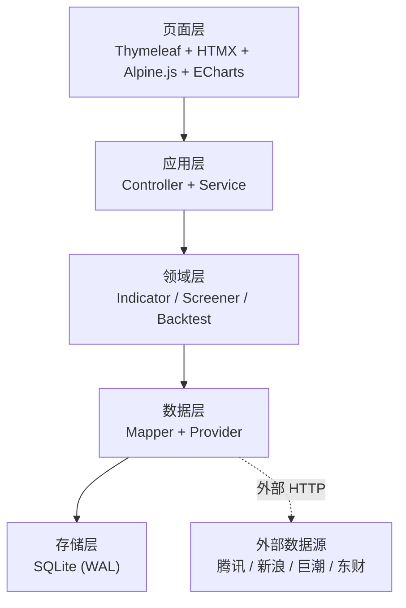
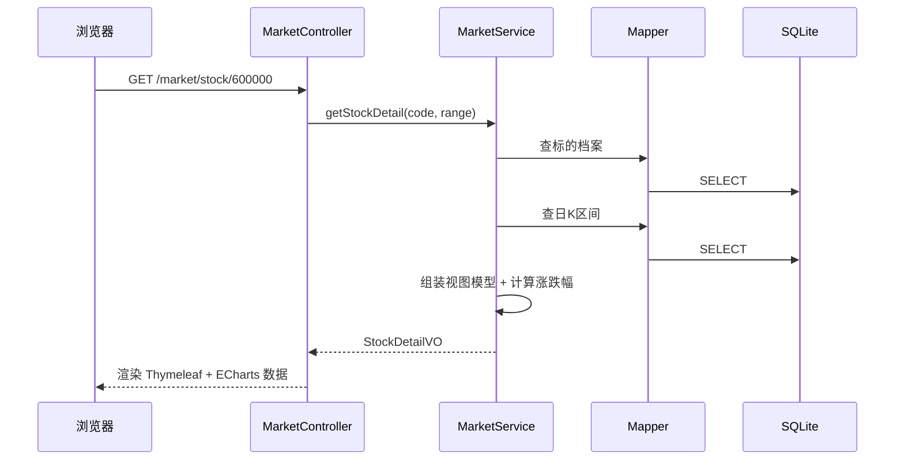

# 架构设计

> 状态：设计定稿（一期）
> 适用范围：一期（选股 / 市场 / 回测）

## 1. 设计目标与原则

| 原则 | 具体含义 |
|---|---|
| 单体优先 | 一个 jar、一个进程、一个 SQLite 文件。不引入微服务、消息队列、Redis、独立前端工程 |
| 慢计算前置 | 指标计算、全市场扫描在收盘后批量跑完并落库；用户请求只做查询，毫秒级响应 |
| 外部依赖可替换 | 所有外部数据源藏在 Provider 接口后面，任一源不可用可切换，业务层无感 |
| 数据可追溯 | 每条落库数据都记录来源、抓取时间、复权方式；异常数据不静默修补 |
| 回测可复现 | 策略定义 hash + 参数 + 数据快照 + 随机种子，同样输入必得同样结果 |

## 2. 系统分层



分层职责与硬约束：

| 层 | 职责 | 禁止 |
|---|---|---|
| 页面层 | 展示、交互、图表渲染 | 直连数据库；直接发外部 HTTP 请求 |
| 应用层 | 参数校验、编排、事务边界、视图模型组装 | 写业务算法；出现裸 SQL |
| 领域层 | 指标计算、选股规则求值、回测撮合 | 依赖 Spring Web；直接访问外部数据源 |
| 数据层 | SQL 执行、外部数据源适配与解析 | 出现业务判断（如「该不该买入」） |
| 存储层 | 持久化 | 被绕过（任何写库都必须经 Mapper） |

## 3. 包结构

```
org.haaasaki.financeagent
├── FinanceAgentApplication.java
├── config/                     配置类（数据源、调度、线程池、Jackson、Web）
├── common/                     工具、异常、常量、通用枚举
├── data/                       数据访问层
│   ├── migration/              SQL 迁移器（自研，按版本执行 db/migration/V*.sql）
│   ├── model/                  持久化 record（与表一一对应）
│   ├── mapper/                 MyBatis Mapper 接口（SQL 在 resources/mapper/*.xml）
│   ├── mybatis/                MyBatis 扩展（如 SQLite 的日期 TypeHandler）
│   ├── support/                数据层小工具（板块判定、统计组装等）
│   ├── provider/               外部数据源适配
│   │   ├── QuoteProvider       行情接口（日K / 分钟K / 快照）
│   │   ├── AnnouncementProvider 公告接口
│   │   ├── EventProvider       结构化事件接口
│   │   ├── tencent/            腾讯实现
│   │   ├── sina/               新浪实现
│   │   ├── cninfo/             巨潮实现
│   │   └── eastmoney/          东财实现
│   └── sync/                   同步任务编排与调度
├── indicator/                  技术指标计算（纯函数，无状态）
├── screener/                   选股模块
│   ├── dsl/                    规则树模型与校验
│   ├── factor/                 因子定义、注册表、求值
│   ├── template/               预设策略模板
│   └── ScreenerService.java
├── backtest/                   回测模块
│   ├── engine/                 交易日循环、组合、撮合
│   ├── cost/                   费用与滑点模型
│   ├── metric/                 绩效指标
│   └── BacktestService.java
├── market/                     市场模块（列表、K线、详情）
└── web/                        控制器与视图模型
    ├── MarketController.java
    ├── ScreenerController.java
    ├── BacktestController.java
    └── SyncController.java
```

## 4. 关键设计决策

### 4.1 为什么是单体 + 服务端渲染

个人自用、单机运行。前后端分离会带来两套工程、CORS、鉴权、构建链、端口管理的额外负担，收益为零。Thymeleaf 服务端渲染 + HTMX 局部刷新可以让后端工程师基本不写 JavaScript。

### 4.2 为什么是 SQLite

| 维度 | 评估 |
|---|---|
| 数据量 | 约 6,600 标的 × 10 年 ≈ 1,500 万行日K，加指标宽表约 2–4 GB |
| 部署 | 零部署，单文件，可直接拷贝备份 |
| 并发 | 单用户读多写少；WAL 模式下读写不互斥，完全够用 |
| 分析查询 | 配合合理索引，全市场扫描在秒级；重计算已由预计算前置解决 |

不选 PostgreSQL 的原因是运维成本对个人项目不成比例；不选 DuckDB 的原因是写入与事务能力弱于 SQLite，而本项目需要频繁增量写入。

### 4.3 为什么指标要预计算

选股的本质是「对全市场 6,600 个标的按时点求值一组条件」。若每次请求都实时计算 MA/MACD/RSI，单次需读取数百万行并做滑动窗口计算，体验不可接受。

因此采用**收盘后批量预计算**：每个交易日收盘后，把当日全市场指标写入 `factor_daily` 宽表。用户选股时只做一次 `WHERE` 查询。

代价与边界：
- 新增指标需回填历史（提供回填任务）
- 盘中不可用于当日实时选股（一期不需要）

### 4.4 为什么 Provider 要做成接口

实测已证明外部数据源不稳定：东财 `push2` / `push2his` 在当前网络下不可达，腾讯接口会**静默降级返回部分数据**，财联社有签名反爬。

因此所有外部访问必须经 Provider 接口，业务层只依赖接口。降级顺序在配置中声明，不写死在代码里。

详见 `docs/DATA_SOURCES.md`。

### 4.5 任务模型

不引入消息队列。异步任务用「数据库任务表 + Spring 线程池」实现：


约束：
- 任务必须**幂等**——同一任务重复执行不产生重复数据（靠唯一约束 + upsert）
- 任务必须**可观察**——状态、进度、错误信息、起止时间落库
- 任务必须**可重试**——失败后可重新触发，不依赖内存状态
- 任务粒度以「一次完整同步」为单位，不做内部断点续传（一期）

一期任务清单：

| 任务 | 触发 | 说明 |
|---|---|---|
| 标的字典同步 | 每日 / 手动 | 拉取全市场股票与 ETF 列表，更新 `instrument` |
| 日K增量同步 | 每日收盘后 | 逐标的拉取最新日K |
| 日K全量初始化 | 手动一次 | 按日期分段拉取 10 年历史 |
| 市场快照同步 | 每日收盘后 / 手动 | 拉取全市场最新行情与估值，写入 `market_snapshot`（每标的保留最新一条） |
| 指数同步 | 手动一次 / 配置变更时 | 按配置拉取指数日K，用于市场概览条 |
| 指标计算 | 日K同步后 | 计算全市场指标写入 `factor_daily` |
| 回测执行 | 页面按钮 | 按策略与参数跑回测 |

## 5. 请求链路

以「打开某只股票详情页」为例：



关键点：**页面渲染期间不发起任何外部 HTTP 请求**。所有数据来自本地库，缺失数据由同步任务补。

## 6. 技术栈与版本

| 组件 | 选型 | 说明 |
|---|---|---|
| JDK | 21 (LTS) | 本机 21.0.6 |
| 构建 | Maven Wrapper | 本机无命令行 mvn，用 `./mvnw` 保证可复现 |
| Web | Spring Boot 3.x（最新稳定版） | 以 Maven Central 实际可用版本为准 |
| 模板 | Thymeleaf | starter-thymeleaf |
| 数据访问 | MyBatis | Mapper 接口 + XML SQL，SQL 完全可控且集中可审 |
| 数据库 | SQLite | `org.xerial:sqlite-jdbc`，WAL 模式 |
| 迁移 | 自研轻量迁移器 | `db/migration/V*.sql` 按版本执行，禁止手工改库结构。不用 Flyway：社区版无 SQLite 支持，其 sqlite 模块（`flyway-database-nc-sqlite`）许可与版本均不确定 |
| 前端交互 | HTMX + Alpine.js | 本地静态资源，不走 CDN |
| 图表 | ECharts | 本地静态资源 |
| 任务调度 | Spring `@Scheduled` + 自建线程池 | 不引 Quartz |
| 测试 | JUnit 5 + Spring Boot Test | 数据层与回测需真实断言 |

## 7. 配置与环境

- 主配置：`src/main/resources/application.yml`
- 本地覆盖：`application-local.yml`（已 gitignore）
- 数据库文件：`./data/finance.db`（已 gitignore，不入库）
- 数据源开关与降级顺序、限速参数均写在配置中，便于调整

## 8. 构建与运行

```bash
./mvnw clean package          # 构建
java -jar target/financeAgent-*.jar   # 运行
./mvnw test                   # 测试
```

启动后访问 `http://localhost:8080`。

## 9. 一期范围边界

**做**：A 股全市场（沪深主板 / 创业板 / 科创板 / 北交所）股票与 ETF 的日K；基于技术指标与基本面因子的条件选股；预设策略模板；用选股结果做单策略回测。

**不做**：港美股、分钟级行情与回测、自动下单与券商接入、用户自定义 SQL 或 Python 表达式、退市股、新闻情感分析、多策略组合与参数寻优。

## 10. 已知风险

| 风险 | 影响 | 应对 |
|---|---|---|
| 外部数据源无 SLA，路径可能变更 | 同步中断 | Provider 抽象 + 多源降级 + 同步失败告警 |
| 腾讯接口静默降级（超限只返回部分数据） | 数据静默缺失 | 落库前校验条数，异常则整批拒绝 |
| 无官方交易日历接口 | 交易日判断错误 | 自建日历表，由已有日K反推，人工校准 |
| 历史 ETF 数据质量参差 | 回测失真 | 回测默认排除上市不足 N 日的标的 |
| 涨跌停规则按板块不同 | 回测成交假设错误 | 按板块与 ST 状态取值，见 DATA_CONTRACT |
