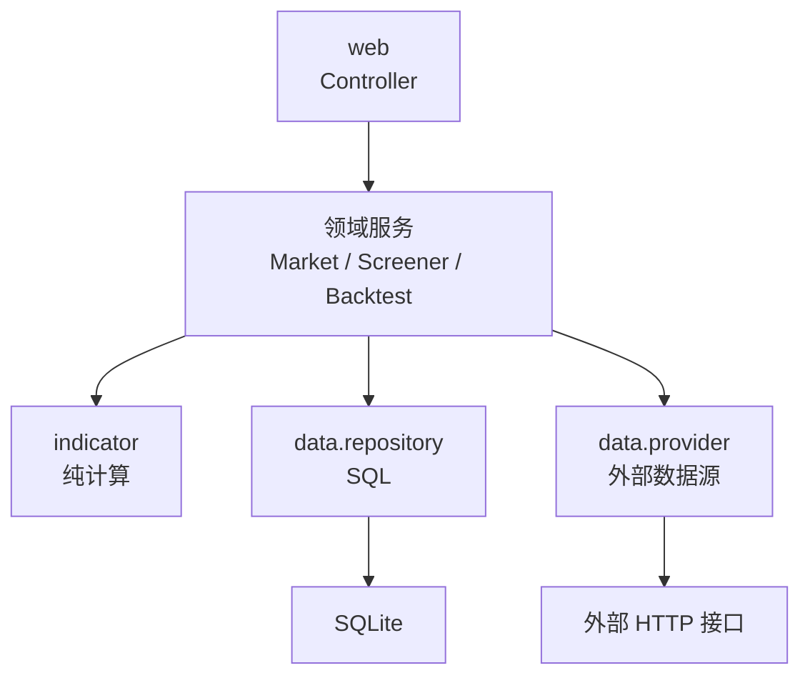

# 后端约束

> 状态：设计定稿（一期）
> 适用于 `src/main/java/org/haaasaki/financeagent/` 下所有代码。

## 1. 依赖方向

分层之间**只能向下依赖**，反向依赖一律禁止。



| 禁止 | 原因 |
|---|---|
| Controller 里出现业务判断或 SQL | 无法测试、职责混乱 |
| 领域层依赖 Spring Web 或 HttpServletRequest | 破坏可测试性 |
| 领域层直接发外部 HTTP | 绕过 Provider 的限速与重试 |
| Mapper 里出现业务规则 | 业务规则散落，回测无法复用 |
| `indicator` 包依赖任何 I/O | 指标必须是可单测的纯函数 |

## 2. Controller 约定

- 只做三件事：**参数绑定与校验、调用 Service、返回视图或片段**。
- 页面路由返回 Thymeleaf 视图名（如 `market/list`）。
- HTMX 局部刷新返回**片段视图**，命名统一加前缀 `fragments/`，如 `fragments/kline-chart`。
- 异步接口返回 JSON DTO，不返回数据库实体。
- 入参校验用 `@Valid` + Jakarta Validation，不手写 if-else 校验。
- 分页参数统一：`page`（从 1 开始）、`size`（默认 20，上限 200）。

## 3. Service 约定

- **事务边界在 Service 层**，`@Transactional` 不加在 Controller 或 Mapper 上。
- 公开方法即用例，命名用动词短语：`syncDailyBars`、`runScreener`、`executeBacktest`。
- 返回视图对象（VO / record），不把数据库实体暴露给上层。
- 长耗时工作（同步、回测）**不在请求线程执行**，只投递任务并立即返回。

## 4. SQL 与数据访问

持久层使用 **MyBatis**：Mapper 接口在 `data/mapper`，SQL 在 `resources/mapper/*.xml`。
保留 `spring-boot-starter-jdbc` 仅为提供 DataSource，以及让迁移器用 JdbcTemplate 执行 DDL。

- 一个表对应一个 Mapper，如 `DailyBarMapper`。
- **SQL 只写在 XML 里**，不用注解式 SQL，也不在 Java 里拼 SQL——集中一处便于审阅与优化。
- **所有变量必须用 `#{}` 占位，禁止 `${}` 拼接**。选股条件 DSL 也不例外——DSL 只映射到**预定义好的字段名与运算符**，字段名来自白名单枚举，不来自用户字符串。
- record 用 `<constructor>` 显式映射，参数顺序必须与 record 头部一致。
- **原始类型的 `javaType` 必须用下划线别名**（`_double` / `_long` / `_int`）。MyBatis 的别名 `double` 指向的是包装类 `Double`，配原始类型的 record 组件会报 `NoSuchMethodException`。
- 批量写入用 `<foreach>` 拼多值 INSERT。SQLite 绑定变量上限 32,766（≥ 3.32），500 条 × 17 列 = 8,500 个参数，安全。
- 写入统一使用 upsert 保证幂等：

```sql
INSERT INTO daily_bar (instrument_id, trade_date, open, high, low, close, ...)
VALUES (#{instrumentId}, #{tradeDate}, #{open}, #{high}, #{low}, #{close}, ...)
ON CONFLICT (instrument_id, trade_date) DO UPDATE SET
    open = excluded.open, high = excluded.high, low = excluded.low,
    close = excluded.close, updated_at = excluded.updated_at;
```

- 批量写入按 **500 条一批** 提交，避免长事务与内存膨胀。
- 全市场扫描类查询必须走索引，禁止无条件全表扫描（见 `DATA_CONTRACT.md` 第 9 节）。

## 5. Provider 约定

- 一个数据类别一个接口（`QuoteProvider`、`AnnouncementProvider`、`EventProvider`）。
- Provider 对外返回**领域对象**，不暴露原始 JSON 结构。
- **协议细节全部封装在实现内部**：编码（腾讯快照是 GBK）、字段顺序（腾讯日K 是开收高低）、单位换算（万元→元、手→股）都不得泄漏到上层。
- 限速、重试、超时、熔断由 Provider 内部的统一客户端封装，业务代码不需要感知。
- 任何 Provider 返回值在落库前**必须通过条数校验**，校验逻辑见 `DATA_SOURCES.md` 第 11 节。
- 降级顺序写进配置：

```yaml
finance:
  providers:
    quote:
      order: [tencent, eastmoney]
      timeout: 15s
      max-retry: 3
      rate-limit-qps: 5
```

## 6. 数值与精度

| 场景 | 类型 | 说明 |
|---|---|---|
| 价格、指标、因子、绩效 | `double` | 性能优先，精度足够 |
| 资金余额、费用、持仓市值 | `BigDecimal` | 金额累加必须精确 |

- 禁止使用 `float`。
- 禁止用 `double` 做资金累加。
- 浮点比较必须给容差（`Math.abs(a - b) < 1e-9`），禁止 `==`。
- 所有对外展示的数值在视图层格式化，不改变存储值。

## 7. 异常处理

- 自定义异常层次：`BusinessException`（用户可见）、`DataSyncException`（可重试）、`DataIntegrityException`（数据校验失败，不可重试）。
- 统一由 `@ControllerAdvice` 处理：页面请求返回错误页，HTMX 请求返回错误片段，API 请求返回 JSON。
- **禁止吞异常**：`catch` 后必须记录日志或重新抛出，不得空块。
- 同步任务中单个标的失败**不中断整批**，但必须记录到 `sync_log`，任务结束时汇总失败数量并给出结论。

## 8. 日志

框架：**SLF4J + Logback**。appender、滚动策略与格式在 `src/main/resources/logback-spring.xml`，
级别开关留在 `application.yml` 的 `logging.level`（改级别比改 XML 方便）。

| 输出 | 用途 | 策略 |
|---|---|---|
| 控制台 | 开发时扫读 | `HH:mm:ss.SSS` + 级别着色 + 短类名 |
| `logs/financeagent.log` | 排查 | 完整时间戳 + 线程 + 类名；50MB 或跨天滚动，gzip 归档到 `logs/archive/`，保留 30 天 / 上限 2GB |
| `logs/error.log` | 同步结束后快速定位 | 仅 WARN 及以上，保留 60 天 / 上限 500MB |

文件写入走 `AsyncAppender`（队列 2048、`discardingThreshold=0`）。**队列满时阻塞而非丢弃**——同步任务一次可能连跑数小时，不能让 IO 拖慢主流程，但日志完整性优先于吞吐。

`logs/` 已在 `.gitignore` 中，不入版本控制。

编码规范：

- 使用 SLF4J 占位符写法，禁止字符串拼接。
- 同步任务必须记录：任务名、起止时间、处理条数、成功/失败数、失败原因摘要，以及**进度**（每 500 个标的打一条 INFO）。
- 单标的失败用 `WARN` 并继续，不中断整批；任务结束时汇总成败数量。
- 回测任务必须记录：策略版本、参数、区间、耗时。
- 日志脱敏：不打印密钥、Token、完整响应体（只打印摘要或长度）。
- 第三方库已降噪（Hikari / Spring / Apache → WARN）。排查连接池等问题时在 `logback-spring.xml` 中单独放开，不要整体调到 DEBUG。

## 9. 异步任务

不引入消息队列。任务模型：

- 任务定义落 `task` 表：类型、参数 JSON、状态、进度、错误信息、起止时间。
- 执行用 Spring `@Async` + 专用线程池（核心 2、最大 4、队列 100）。
- **任务必须幂等**：重复执行不产生重复数据，依赖唯一约束与 upsert。
- 任务状态机：`PENDING → RUNNING → SUCCESS | FAILED | CANCELLED`。
- 进度更新要限频（如每 200 条更新一次），避免高频写库。
- 页面通过 HTMX 轮询任务状态片段，不引入 WebSocket。

## 10. 配置

- `application.yml`：公共配置，入库。
- `application-local.yml`：本地覆盖，**已 gitignore，不入库**。
- 数据库文件路径、数据源降级顺序、限速参数、同步开关均走配置，不硬编码。
- 不写死本机绝对路径。

## 11. 测试要求

| 层次 | 要求 |
|---|---|
| `indicator` | 纯函数单测，用固定输入输出对拍，覆盖边界（空序列、单点、除零） |
| Mapper | 用真实 SQLite 临时库测试真实 SQL，不用 Mock |
| Provider | 用固定响应样本测解析（含编码、字段顺序、单位换算），不发真实请求 |
| 回测引擎 | 固定区间 + 固定数据快照，断言净值与交易明细，保证可复现 |
| Service | 关键用例的成功与主要失败路径 |

禁止把估算数据或 Mock 数据当作真实结果写进正式表。

## 12. 代码风格

- 遵循 Google Java Style，4 空格缩进，行宽 120。
- 优先使用 `record` 承载不可变数据（VO、DTO、因子定义）。
- 优先使用 `switch` 表达式与模式匹配（Java 21 已支持）。
- 使用 `Optional` 表达可能缺失的返回值，**禁止返回 null 集合**（返回空集合）。
- 公共方法必须有 Javadoc 说明单位与口径；涉及金融语义的方法必须标明复权方式与时点。
- record 的**每个组件都必须有 `@param` 注释**，说明单位与缺失语义。record 没有 getter/setter，字段说明只能由类级 Javadoc 承载，IDE 悬停提示也来自这里。
