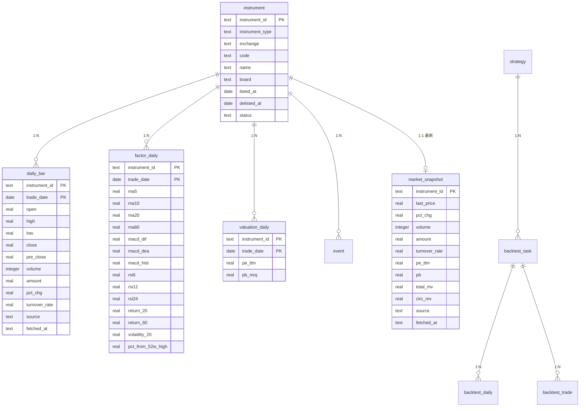

# 数据语义契约

> 状态：设计定稿（一期）
> 本文件是数据口径的唯一事实来源。任何代码与本节冲突，以本节为准。

## 1. 标的标识

**统一使用 `instrument_id`，格式 `{code}.{exchange}`，全局唯一。禁止用裸股票代码跨表关联。**

| 市场 | exchange | 示例 | 说明 |
|---|---|---|---|
| 沪市 | `SH` | `600000.SH` | 含主板、科创板 |
| 深市 | `SZ` | `000001.SZ` | 含主板、创业板 |
| 北交所 | `BJ` | `920000.BJ` | |
| 指数 | `SH` / `SZ` | `000300.SH` | 与个股同表，靠 `instrument_type` 区分 |

`instrument_type` 取值：`STOCK` / `ETF` / `INDEX`。
`board`（板块）取值：`MAIN` / `GEM`（创业板）/ `STAR`（科创板）/ `BSE`（北交所）/ `ETF` / `INDEX`。

## 2. 单位与精度

**所有百分比统一以小数存储**（12.5% 存 `0.125`）。展示层负责转成百分号。

| 字段 | 单位 | 存储类型 | 说明 |
|---|---|---|---|
| open / high / low / close / pre_close | 元 | REAL | 分位精度（2 位小数） |
| volume | **股** | INTEGER | 注意：腾讯接口返回单位是「手」，同步时 ×100 |
| amount | 元 | REAL | 成交额 |
| pct_chg | 小数 | REAL | 涨跌幅，0.125 = 12.5% |
| turnover_rate | 小数 | REAL | 换手率 |
| pe_ttm / pb | 倍 | REAL | 亏损时为空，不填 0 |
| total_mv / circ_mv | 元 | REAL | 总市值 / 流通市值 |
| 费用率、胜率、收益率 | 小数 | REAL | 一律小数 |

数值类型使用策略：

- **价格、指标、因子、绩效** → `double`（性能优先，精度足够）
- **资金账户余额、费用、持仓市值** → `BigDecimal`（涉及金额累加，必须精确）

禁止用 `float`。禁止用 `double` 做资金累加。

**因子口径**：`factor_daily` 的技术指标定义（窗口、公式、缺失语义）以
`docs/work-items/WI-003-指标计算与因子表.md` 第 2.2 节为准；全部基于前复权收盘价，
按标的自身 bar 序列滚动（不对齐日历），回看不足的列保持 NULL。

**估值口径**：`valuation_daily` 存逐日 PE-TTM / PB-MRQ（东财数据中心），单位为倍；
非正值（亏损、负净资产）视为无效，**存 NULL，禁止填 0**。历史截面回测以当日
`valuation_daily` 行取数，口径与边界见 `docs/work-items/WI-007-历史估值数据源.md`。

## 3. 复权

**一期采用前复权（qfq）作为 `daily_bar` 的唯一价格口径**，用于指标计算与回测。

代价与应对——前复权价的固有问题是**每次除权都会重算全部历史价格**，若只做增量追加，历史数据会与新数据不一致：

> 同步每当拉取最近 N 条数据后，必须与库中重叠日期逐条比对 `close`。
> 若发现同一日期价格不一致，判定为发生除权，**触发该标的的全量重拉**（覆盖写入）。
> 比对不通过且重拉仍失败时，该标的标记为 `STALE` 并记录告警，不得静默通过。

一期不做原始价与复权因子分离存储。若后续需要多口径（不复权 / 后复权）切换，再引入 `adj_factor` 表并迁移。

## 4. 交易日与日历

- 交易日历存 `trading_calendar` 表，字段 `trade_date`、`is_open`。
- 冷启动时由**已同步的指数日K（沪深300）反推**交易日，之后人工校准。
- A 股时区固定 `Asia/Shanghai`，`trade_date` 为**无时区日期**（不存时间戳）。
- 半日市、临时休市等特殊情形记录在日历表的备注字段中。
- 禁止用「周一到周五」直接推导交易日。

## 5. 停牌、退市与缺失数据

| 情形 | 落库表现 | 禁止 |
|---|---|---|
| 停牌 | 该日**无记录**（不是 0、不是 NULL 行） | 伪造 0 成交量行 |
| 未上市 | 早于 `listed_at` 无记录 | 用今日状态回填历史 |
| 已退市 | 一期不纳入标的池 | — |
| 数据缺失 | 该日无记录，并在 `sync_log` 记录缺口 | 静默跳过、补零 |

- 标的状态字段 `status`：`LISTED` / `SUSPENDED` / `DELISTED`，**读取时必须按历史日期判断，不能用当前状态代表历史**。
- 缺失数据一律「无记录」，不用哨兵值（-1、0、9999）替代。

## 6. 涨跌停规则

回测撮合的涨跌停判定**必须按板块与 ST 状态取值**，不得统一按 10%。

| 板块 | 代码特征 | 涨跌停幅度 |
|---|---|---|
| 沪市主板 | 600 / 601 / 603 / 605 | ±10% |
| 深市主板 | 000 / 001 / 002 / 003 | ±10% |
| 创业板 | 300 / 301 | ±20% |
| 科创板 | 688 / 689 | ±20% |
| 北交所 | 8xx / 920 | ±30% |
| ST / *ST | 任意（名称含 ST） | ±5% |
| 新股上市前 5 个交易日 | — | 无涨跌停限制 |

一期简化：**上市不足 5 个交易日的标的直接排除出回测样本**，避免处理新股特殊规则。

判定「一字板不可成交」时，使用当日 `open == high == low == close` 且触及涨跌停价作为依据；不能仅凭 `pct_chg` 达到上限就假设无法成交。

## 7. 数据可用时点（防未来函数）

每条数据必须能回答「它在什么时刻变得可用」。回测中 T 日决策只能使用 `available_at <= T` 的数据。

| 数据 | available_at 定义 |
|---|---|
| 日K | 该交易日收盘后（15:00） |
| 估值（PE/PB） | 该交易日收盘后；历史序列见 `valuation_daily`（WI-007） |
| 财务数据 | **实际披露时间**，不是报告期末 |
| 公告 / 事件 | 公告发布时间 |
| 快照类（PE/PB/市值） | 抓取时刻 |

硬约束：

- 财务类因子必须按披露时间过滤。例：报告期为 2026-09-30 的业绩预告，若 2026-10-25 才披露，则 2026-10-24 及之前的回测中不可见。
- 回测记录必须保存数据快照标识、策略版本、参数、基准、费用与滑点，保证可复现。

## 8. 来源与审计

每条行情记录保留：

| 字段 | 含义 |
|---|---|
| `source` | 来源标识，如 `TENCENT_FQKLINE` |
| `fetched_at` | 抓取时刻 |
| `data_status` | 数据质量状态 |

`data_status` 取值：

| 值 | 含义 |
|---|---|
| `ACCEPTED` | 校验通过 |
| `PARTIAL` | 部分字段缺失（如换手率未补全） |
| `STALE` | 数据可能过期或复权基准未更新 |
| `REJECTED` | 校验失败，不参与计算 |

**校验规则**：同步落库前必须校验返回条数与预期一致。腾讯接口在参数超限时会静默降级返回部分数据（HTTP 200 但条数变少），因此**禁止仅凭 HTTP 状态码判定同步成功**。

## 9. 表约束约定

- 所有时间序列表主键为 `(instrument_id, trade_date)`，使用 `INSERT ... ON CONFLICT DO UPDATE` 保证幂等。
- 所有表必须有 `created_at`；可变表需有 `updated_at`。
- 金额与价格字段不允许 NULL 表示 0，NULL 仅表示未知。
- 索引：`daily_bar(trade_date)`（按日全市场扫描）、`factor_daily(trade_date)`、`valuation_daily(trade_date)`、`event(instrument_id, event_date)`。
- 数据库结构变更一律通过 `src/main/resources/db/migration/V*.sql` 迁移脚本，**禁止手工改库**。

## 10. 合规边界

- 巨潮资讯公告为法定披露信息，可用。
- 新闻类内容有版权：**个人自用可抓取，但只存标题、链接、时间，不入库正文全文，不商用、不再分发**。
- 不把模拟数据、估算数据当作真实结果展示或写入正式表。
