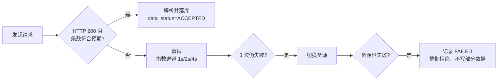

# 数据源规格与容错

> 状态：一期实测结论
> 本文所有结论均来自本机实测，非文档推测。修改 Provider 前必读。

## 1. 总览

| 数据类别 | 主源 | 备源 | 实测状态 |
|---|---|---|---|
| 日K行情 | 腾讯 `fqkline` | 东财 `push2his` | 主源可用；备源本机不可达 |
| 分钟K | 腾讯 `mkline` | — | 可用（一期不用） |
| 实时快照 | 腾讯 `qt.gtimg.cn` | 新浪 | 可用 |
| 全市场列表 / 估值快照 | 新浪 `Market_Center` | 东财 `push2` | 主源可用；备源本机不可达 |
| 历史估值（PE-TTM / PB-MRQ） | 东财 `datacenter-web` | — | 可用（WI-007） |
| 官方公告 | 巨潮 `cninfo` | 东财 `np-anotice-stock` | 均可用 |
| 结构化事件 | 东财 `datacenter-web` | — | 可用（二期使用） |
| 财经快讯 | 东财 `np-listapi` | 新浪 `feed.mix` | 可用（二期使用） |

**重要事实**：东财各子域可达性互相独立。`datacenter-web`、`np-*` 可用，但 `push2`、`push2his` 在本机网络下不可达（502 / 连接失败）。因此「东财不能用」的判断是错的，只有行情系列子域不行。

## 2. 腾讯日K（主源）

```
GET https://ifzq.gtimg.cn/appstock/app/fqkline/get
    ?param={code},{period},{start},{end},{count},{fq}
```

| 参数 | 取值 | 说明 |
|---|---|---|
| `code` | `sh600000` / `sz000001` / `sh510300` | 小写交易所前缀 + 代码 |
| `period` | `day` / `week` / `month` | 一期只用 `day` |
| `start` / `end` | `2016-01-01` | 可同时留空 |
| `count` | 整数 | **上限 800**，见下方陷阱 |
| `fq` | `qfq` / `hfq` / 留空 | 前复权 / 后复权 / 不复权 |

返回结构：

```json
{"code":0,"data":{"sh600000":{"qfqday":[["2024-09-02","7.540","7.560","7.670","7.520","421786.000"], ...]}}}
```

字段顺序为 **`[日期, 开, 收, 高, 低, 成交量(手)]`**——注意是「开收高低」，不是常见的「开高低收」。这是最容易写错的一处。

### 必须知道的三个陷阱

**陷阱一：count 上限是 800，超限静默降级**

| 请求 count | 实际返回 |
|---|---|
| ≤800 | 与请求一致 |
| 880 / 900 / 1000 / 2000 | **静默只返回 640 条** |
| ≥4000 | 空响应 |

超限时 **HTTP 状态码仍是 200**，不报错、不提示，只是少给数据。**禁止仅凭状态码判定成功，必须校验返回条数。**

**陷阱二：10 年历史取不到一次请求**

800 条日K ≈ 3.2 年。取 10 年历史必须**按日期区间分段**，实测可行：

```
param=sh600000,day,2016-01-01,2016-12-31,640,qfq   → 226 条，正确覆盖 2016 全年
param=sh600000,day,2005-01-01,2005-12-31,640,qfq   → 239 条，可回溯至 2005 年
```

每只标的约 4 段请求；全市场 6,600 标的约 2.6 万次请求。

**陷阱三：域名不是唯一的**

| 域名 | 实测结果（2026-09-13） |
|---|---|
| `ifzq.gtimg.cn` | **前置腾讯 WAF**：curl 正常，但 Java HttpClient / Python urllib 持续返回 501（响应体跳转 `waf.tencent.com/501page`），更换 UA / Accept 头无效。批量抓取会整批失败 |
| `web.ifzq.gtimg.cn` | **可用**（TAPISIX 网关，返回结构与主域一致），设为默认主源 |
| `web3.ifzq.gtimg.cn` | 本机不可达，不用 |

日K域名按 `finance.providers.quote.tencent-kline-hosts` 配置顺序回退，默认 web 域优先；
主源抛 `DataSyncException` 时自动切换下一源，数据校验类错误不触发切换。
Provider 还会**记住最近一次成功的域名**（粘性），后续请求优先使用，
避免每个日期分段都先撞击失败源、白耗退避时间（实测长跑中两者会被 WAF 交替拦截）。

## 3. 腾讯分钟K（一期不使用）

```
GET https://ifzq.gtimg.cn/appstock/app/kline/mkline
    ?param={code},{period},,{count}
```

`period` 取值 `m1` / `m5` / `m15` / `m30` / `m60`，上限同为 800 条。

返回 `["202609111445","9.26","9.26","9.26","9.25","12748.00",{},"0.38"]`，即 `[时间, 开, 收, 高, 低, 量(手), {}, 均价]`。

**历史深度极浅**：m1 仅约 3.3 个交易日，m5 约 16 个交易日。只能用于看盘，不能用于回测。一期不采集。

## 4. 腾讯实时快照

```
GET https://qt.gtimg.cn/q=sh600000,sz000001,sh510300
```

返回 **GBK 编码**的自由文本，`v_sh600000="1~浦发银行~600000~9.26~..."`，字段以 `~` 分隔。使用前必须转码，否则中文名称乱码。

## 5. 新浪 全市场列表与估值快照

```
GET https://vip.stock.finance.sina.com.cn/quotes_service/api/json_v2.php/
    Market_Center.getHQNodeData?page=1&num=100&sort=symbol&asc=1&node=hs_a
```

分页拉取（`num` 最大 100），`node=hs_a` 为全部 A 股（含北交所）。

返回字段：

| 字段 | 含义 | 单位 |
|---|---|---|
| `symbol` / `code` / `name` | 代码与名称 | |
| `trade` / `open` / `high` / `low` / `settlement` | 价格 | 元 |
| `volume` / `amount` | 成交量 / 成交额 | 股 / 元 |
| `per` / `pb` | 市盈率 / 市净率 | 倍 |
| `mktcap` / `nmc` | 总市值 / 流通市值 | **万元** |
| `turnoverratio` | 换手率 | 百分数数值 |

注意：`mktcap`、`nmc` 单位是**万元**，落库需转成元（×10000）；`turnoverratio` 返回的是百分数数值（如 `0.94246` 表示 0.94%），需按契约转成小数。

用途：补全腾讯日K缺失的**成交额、换手率、PE/PB、市值**。

## 6. 巨潮资讯 官方公告（二期）

两步调用，必须带 `Referer`，否则可能返回空。

**第一步，查 orgId**：

```
POST http://www.cninfo.com.cn/new/information/topSearch/query
Referer: http://www.cninfo.com.cn/
Body: keyWord=000001&maxNum=3
```

返回 `[{"code":"000001","orgId":"gssz0000001","zwjc":"平安银行", ...}]`

**第二步，查公告**：

```
POST http://www.cninfo.com.cn/new/hisAnnouncement/query
Referer: http://www.cninfo.com.cn/new/commonUrl?url=disclosure/list/notice
Body: pageNum=1&pageSize=30&column=szse&tabName=fulltext
      &stock=000001,gssz0000001&seDate=&searchkey=&sortName=&sortType=&isHLtitle=true
```

`column` 取 `szse`（深）或 `sse`（沪）。`stock` 可省略以按日期拉全市场，`seDate` 格式 `2026-09-10~2026-09-12`。

实测：平安银行返回 1,993 条；全市场两天 4,663 条。

关键字段：`announcementTitle`、`announcementTime`（毫秒时间戳）、`adjunctUrl`（PDF 路径）、`secCode`、`secName`。

## 7. 东财 结构化事件（二期，价值最高）

```
GET https://datacenter-web.eastmoney.com/api/data/v1/get
    ?reportName={报表名}&columns=ALL&pageNumber=1&pageSize=100
    &sortColumns={排序字段}&sortTypes=-1&source=WEB&client=WEB
```

实测可用的 `reportName`：

| reportName | 内容 | 规模 |
|---|---|---|
| `RPT_LIFT_STAGE` | 限售解禁 | 15,749 页 |
| `RPT_PUBLIC_OP_NEWPREDICT` | 业绩预告 | 95,460 页 |
| `RPT_DAILYBILLBOARD_DETAILSNEW` | 龙虎榜 | 134,059 页 |
| `RPT_SHAREBONUS_DET` | 分红送转 | 28,487 页 |

直接返回结构化 JSON，无需解析 PDF 或文本。这是把「事件」变成选股因子的最短路径。

### 7.1 历史估值 RPT_VALUEANALYSIS_DET（WI-007）

```
GET https://datacenter-web.eastmoney.com/api/data/v1/get
    ?reportName=RPT_VALUEANALYSIS_DET
    &columns=SECURITY_CODE,TRADE_DATE,PE_TTM,PB_MRQ
    &filter=(SECURITY_CODE="600000")(TRADE_DATE>='2026-09-08')
    &pageNumber=1&pageSize=500
    &sortColumns=TRADE_DATE&sortTypes=-1
    &source=WEB&client=WEB
```

| 项 | 实测结论（2026-09-13） |
|---|---|
| 分页 | `pageSize` 服务端上限 **10,000**（请求 20,000/50,000 均只返回 10,000）；使用 **5,000** 更稳 |
| 过滤 | 支持多代码 `in` 与 `(TRADE_DATE>='yyyy-MM-dd')` 过滤，可组合 |
| **限流教训** | 多代码大批量 + 深分页（page≥5）会被服务端**连接重置**（`请求失败 - url`，非 HTTP 状态），并可能触发数分钟级 IP 冷却；实测恢复约 2~5 分钟。**禁止构造大结果集深分页** |
| 限流后处理 | 同一 JVM 若持续被重置（curl 正常但 Java 全部失败），说明该进程的连接池已被污染：**重启进程并等待 2~5 分钟冷却**，实测重启后恢复并且逐代码速率可达约 2 只/秒 |
| 稳定取数策略 | 全量：逐代码单页（单只约 2,100 行 < 5,000）；增量：逐日分片（单日约 5,500 行 = 1~2 页），避开深 offset |
| 覆盖深度 | 600000 约 2,111 条，最早约 2017-11；各家略有差异 |
| 日期格式 | `2026-09-11 00:00:00`，取前 10 位为交易日 |
| 单位 | PE_TTM / PB_MRQ 均为倍，直接存储；非正值（亏损/负净资产）视为无效置 null，不填 0 |
| 空数据 | ETF 等返回 `success=false, code=9201, message=返回数据为空`，视为「无数据」按成功跳过 |
| 批次一致性 | 单标的（或单日窗口）所有分页全部成功才写库；条数不符抛 `DataSyncException`，整批拒绝 |

回填任务：`--valuation.init`（有日K的股票）/ `--valuation.update`（从各标的库内最新估值日次日起）；
`--sync.incremental` 完成后自动衔接因子增量与估值增量。落库口径见 `docs/work-items/WI-007-历史估值数据源.md`。

## 8. 东财 公告（带分类标签，二期）

```
GET https://np-anotice-stock.eastmoney.com/api/security/ann
    ?sr=-1&page_size=50&page_index=1&ann_type=A&client_source=web&stock_list=600000
```

相比巨潮，优势是带 `columns[].column_name` **公告分类**（如「高管人员任职变动」），便于事件归类。

## 9. 财经快讯（二期）

- 东财：`GET https://np-listapi.eastmoney.com/comm/web/getNewsByColumns?client=web&biz=web_news_col&column=350&order=1&needInteractData=0&page_index=1&page_size=20&req_trace=1`
- 新浪：`GET https://feed.mix.sina.com.cn/api/roll/get?pageid=153&lid=2516&num=20&page=1`

## 10. 不可用数据源（不要浪费时间）

| 源 | 现象 | 结论 |
|---|---|---|
| `push2.eastmoney.com` | 持续 502 | 本机不可达 |
| `push2his.eastmoney.com` | 连接失败（http=000），偶发可通 | 不稳定，只作备源 |
| `www.cls.cn/nodeapi/updateTelegraphList` | 404，需签名参数 | 有反爬，放弃 |
| `web3.ifzq.gtimg.cn` | 不可达 | 不用 |

## 11. 通用容错策略

所有 Provider 实现必须遵守：



| 策略 | 参数 | 依据 |
|---|---|---|
| 请求限速 | 默认 5 QPS（间隔 0.2s） | 实测 3.3 QPS 连发 30 次零失败，留出余量 |
| 重试 | 最多 3 次，退避 1s / 2s / 4s | |
| 熔断冷却 | 连续失败 5 次暂停 60s | 实测限流后冷却约 20s 恢复 |
| 条数校验 | 落库前比对预期条数 | 防静默降级 |
| 分批提交 | 每 500 条一个事务 | 失败不污染整表 |
| 幂等 | `INSERT ... ON CONFLICT DO UPDATE` | 任务可重复执行 |

**限流信号**：除 HTTP 429 外，新浪在短时间内被连续全量抓取时返回 **HTTP 456**（实测：连续两次全市场快照抓取，第二次首发请求即 456）。二者都按限流处理并退避重试；快速连续重触发的任务应等待冷却窗口。

**硬性要求**：校验不通过时**整批拒绝**，不允许「能写多少写多少」。部分写入产生的数据缺口比同步失败更危险，因为它不会被发现。

## 12. 新增数据源的流程

1. 先在命令行实测可用性与返回结构，把结论补进本文件。
2. 定义或复用 Provider 接口，确认返回值能映射到 `DATA_CONTRACT.md` 的单位与口径。
3. 实现后必须在数据层测试中覆盖：正常返回、超限降级、空响应、超时四种情况。
4. 在配置中登记降级顺序，不写死在代码里。
